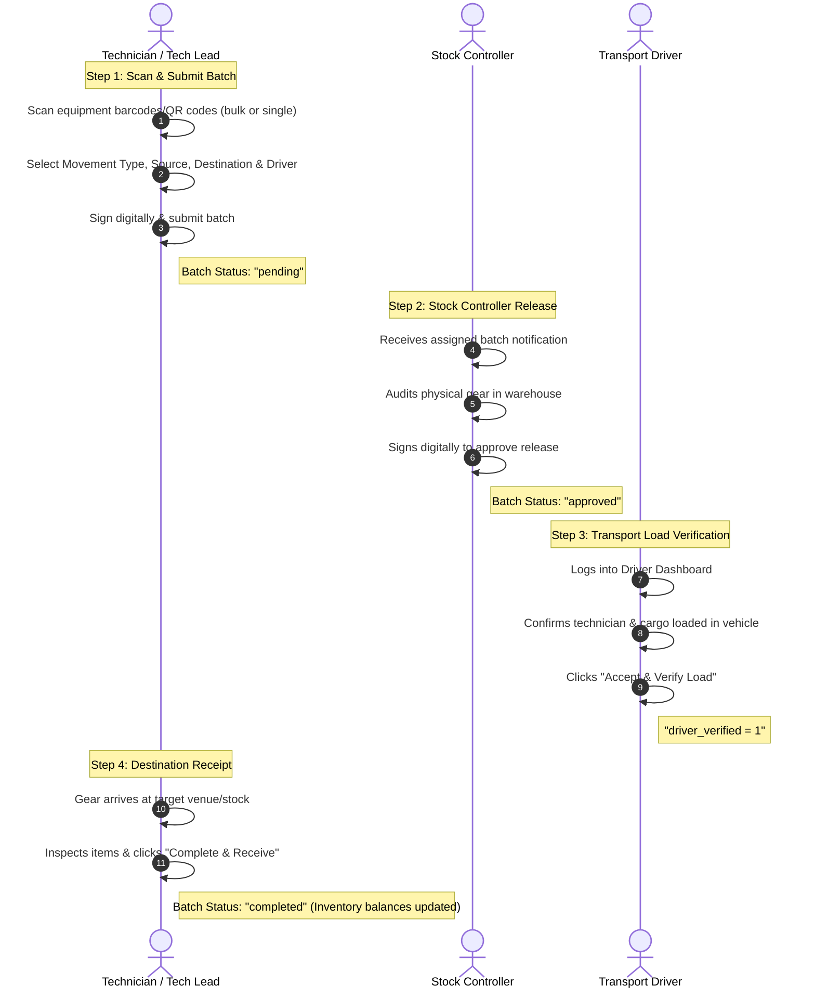

# 🚀 aBility - Advanced Inventory & Asset Management System

**aBility** is an enterprise-grade **Asset Intelligence Engine** designed to manage, audit, and track high-value equipment across warehouses, transport logistics, and event venues. Unlike traditional passive inventory lists, **aBility** enforces a **digital chain of custody** with multi-role signatures, barcode/QR bulk scanning, driver transport verification, and real-time movement auditing.

---

## 📋 Table of Contents
1. [System Overview & Key Features](#-system-overview--key-features)
2. [Asset Movement Lifecycle & Workflow](#-asset-movement-lifecycle--workflow)
3. [Project Scaffolding & Development Environment Setup](#-project-scaffolding--development-environment-setup)
4. [Database Integration & Schema Management](#-database-integration--schema-management)
5. [Live Deployment & Hosting Guide](#-live-deployment--hosting-guide)
6. [Best Practices: Security, Testing & Performance](#-best-practices-security-testing--performance)
7. [Directory & File Structure](#-directory--file-structure)

---

## 🌟 System Overview & Key Features

* **Real-time Barcode & QR Code Scanning**: Fast bulk and single item scanning supporting hardware USB/Bluetooth scanners and mobile device camera scanning.
* **Digital Chain of Custody**: Every equipment transfer requires a multi-role digital handshake (Technician submit → Stock Controller approve → Driver verify load → Venue receive).
* **Dual-Signature Audit Trail**: Dynamically captures and embeds user signatures into official PDF Gate Passes and Material Requisitions.
* **Role-Based Access Control (RBAC)**: Fine-grained permissions for `admin`, `stock_controller`, `technician`/`tech_lead`, and `driver`.
* **Support for 4 Core Movement Types**:
  1. **Stock-to-Stock**: Inter-warehouse transfers (requires driver & gate pass).
  2. **Stock-to-Venue**: Moving gear from warehouse to event sites (requires driver & gate pass).
  3. **Venue-to-Stock**: Returning gear after events (requires driver & gate pass).
  4. **Direct Movement**: Internal transfers or direct handovers without transport.
* **Driver Logistics Portal**: Dedicated dashboard for drivers to review cargo lists, verify loaded items, and acknowledge transport responsibility.
* **Automated QR & Label Printing**: Batch printable QR code labels for fast tagging and inventory audits.

---

## 🔄 Asset Movement Lifecycle & Workflow



---

## 🛠️ Project Scaffolding & Development Environment Setup

### Prerequisites
* **PHP**: 8.1 or higher (with extensions: `pdo_mysql`, `gd`, `mbstring`, `curl`, `json`, `openssl`).
* **Database**: MySQL 8.0+ or MariaDB 10.4+.
* **Web Server**: Apache 2.4+ (with `mod_rewrite` enabled) or Nginx.
* **Environment**: Local LAMP/XAMPP stack or standalone PHP environment.
* **Package Manager**: [Composer](https://getcomposer.org/) for managing PHP libraries.

### Step-by-Step Local Setup

1. **Clone / Place Project Files**
   Copy the project into your local server root (e.g. `C:\xampp\htdocs\ability_app_main` or `/var/www/html/ability_app_main`).

2. **Configure Environment Variables**
   Create a `.env` file in the root directory (or update `config.php`):
   ```env
   DB_HOST=localhost
   DB_USER=root
   DB_PASS=your_password
   DB_NAME=ability_db
   APP_ENV=development
   BASE_URL=http://localhost/ability_app_main/
   ```

3. **Install Dependencies**
   Run Composer to install required PHP packages (such as FPDF/TCPDF for PDF generation):
   ```bash
   composer install
   ```

4. **Verify Upload Directories**
   Ensure the following directories exist and have write permissions:
   * `uploads/signatures/`
   * `uploads/items/`
   * `assets/qrcodes/`

---

## 🗄️ Database Integration & Schema Management

### Initializing the Database

1. **Import Database Dump**
   Import `ability_db (v).sql` or run the database migration script:
   ```bash
   mysql -u root -p ability_db < "ability_db (v).sql"
   ```
   Or execute `create_tables.php` via browser: `http://localhost/ability_app_main/create_tables.php`.

2. **Key Schema Tables**:
   * `users`: Stores user credentials, roles (`admin`, `stock_controller`, `technician`, `driver`), and digital signature file paths.
   * `items`: Asset catalog including serial numbers, barcode/QR data, categories, and current stock locations.
   * `stock_movements`: Master records for equipment movement batches, tracking source, destination, status, and signatures.
   * `stock_movement_items`: Junction table mapping specific items included in each movement batch.
   * `scan_logs`: History of individual scans for full operational auditability.

### Database Access Best Practices (PDO & Prepared Statements)

Always use PDO prepared statements to query the database and prevent SQL injection:

```php
// Example: Fetching pending batches securely
$stmt = $pdo->prepare("SELECT * FROM stock_movements WHERE status = :status AND stock_controller_id = :controller_id");
$stmt->execute([
    'status' => 'pending',
    'controller_id' => $user_id
]);
$batches = $stmt->fetchAll(PDO::FETCH_ASSOC);
```

---

## 🌐 Live Deployment & Hosting Guide

### 1. Server Environment Setup (Ubuntu 22.04 LTS / LAMP)
Install required packages:
```bash
sudo apt update
sudo apt install apache2 mysql-server php8.2 php8.2-mysql php8.2-gd php8.2-curl php8.2-mbstring php8.2-xml zip unzip libapache2-mod-php -y
sudo a2enmod rewrite
sudo systemctl restart apache2
```

### 2. File Deployment & File Permissions
Upload application files to `/var/www/ability_app_main/` and set proper directory permissions:
```bash
sudo chown -R www-data:www-data /var/www/ability_app_main
sudo chmod -R 755 /var/www/ability_app_main
sudo chmod -R 775 /var/www/ability_app_main/uploads /var/www/ability_app_main/assets/qrcodes
```

### 3. Apache Virtual Host Configuration (`/etc/apache2/sites-available/ability.conf`)
```apache
<VirtualHost *:80>
    ServerName ability.yourdomain.com
    DocumentRoot /var/www/ability_app_main

    <Directory /var/www/ability_app_main>
        Options -Indexes +FollowSymLinks
        AllowOverride All
        Require all granted
    </Directory>

    ErrorLog ${APACHE_LOG_DIR}/ability_error.log
    CustomLog ${APACHE_LOG_DIR}/ability_access.log combined
</VirtualHost>
```
Enable site and restart Apache:
```bash
sudo a2ensite ability.conf
sudo systemctl reload apache2
```

### 4. Enable SSL/HTTPS with Let's Encrypt
```bash
sudo apt install certbot python3-certbot-apache -y
sudo certbot --apache -d ability.yourdomain.com
```

### 5. Production Environment Hardening
In `config.php`, ensure development errors are disabled:
```php
// Production error setting
error_reporting(0);
ini_set('display_errors', 0);
```

---

## 🔒 Best Practices: Security, Testing & Performance

### Security Standards
* **Session Hardening**: Secure session cookie parameters (`httponly`, `samesite=Lax`, `secure` on HTTPS) configured in `config.php`.
* **Password Hashing**: Passwords stored using PHP's native `password_hash($pass, PASSWORD_BCRYPT)`.
* **Input Sanitization & Escaping**: All user inputs sanitized before rendering using `htmlspecialchars($val, ENT_QUOTES, 'UTF-8')`.
* **Access Control Checks**: Role validation on all API endpoints (`api/submit_batch.php`, `api/batches/approve.php`).
* **CSRF Protection**: Token validation recommended for sensitive POST actions.

### Testing Strategy
* **Unit & Integration Testing**: Set up PHPUnit for API endpoints:
  ```bash
  ./vendor/bin/phpunit tests/BatchMovementTest.php
  ```
* **Manual Verification Checklist**:
  1. Test bulk barcode scanning on mobile and desktop.
  2. Verify dual-signature flow (Stock Controller + Technician).
  3. Validate Driver dashboard verification and cargo lock.
  4. Verify PDF Gate Pass generation and layout rendering.

### Performance Optimization
* **Database Indexes**: Indexed foreign keys (`batch_id`, `item_id`, `submitted_by`, `stock_controller_id`, `driver_id`).
* **Asset Caching**: Enable HTTP caching in `.htaccess` for CSS, JS, and image assets.
* **Lazy Loading**: Paginate large inventory tables (`items.php`, `batch_history.php`).

---

## 📁 Directory & File Structure

```
ability_app_main/
├── api/                     # REST API backend scripts (submit, approve, verify)
│   ├── submit_batch.php     # Handles new batch submission
│   ├── batches/             # Approval & status modification endpoints
│   └── ...
├── assets/                  # Frontend assets (CSS, JS, Fonts, QR codes)
│   ├── css/                 # Custom stylesheet & theme definitions
│   ├── js/                  # Scanning scripts & interactive UI handlers
│   └── qrcodes/             # Generated QR code image files
├── config/                  # Configuration & bootstrap initialization
├── config.php               # Master database & system constants config
├── gate_pass.php            # PDF & HTML printable Gate Pass generator
├── items.php                # Main equipment & asset catalog interface
├── scan_bulk.php            # Bulk barcode & QR scanning interface
├── driver_batches.php       # Dedicated Driver verification portal
├── role_access_matrix.php   # RBAC permission matrix configuration
├── uploads/                 # Storage for user signatures and item photos
│   └── signatures/          # High-resolution digital signature files
├── ability_db (v).sql       # Complete MySQL database export
├── composer.json            # Composer PHP dependency specifications
└── README.md                # System documentation
```

---

## 📝 License & Maintainers
* **Project**: aBility Asset Intelligence & Inventory System
* **Maintainer**: Enterprise Engineering Team
