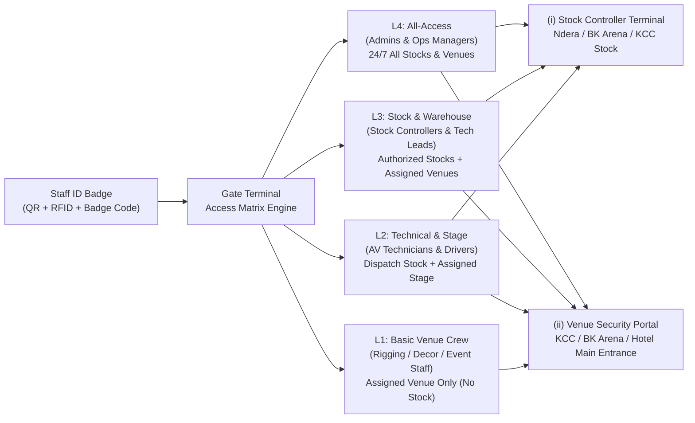

# Gate Terminal — Unified Access Matrix Solution (Pitch & Implementation Plan)

---

## Part 1: Executive Pitch Strategy ("How to Pitch It")

### 1. The Core Hook (30-Second Elevator Pitch)
> *"Right now, equipment security and crew attendance live in disconnected silos—anyone in a vest can walk into a stock room or backstage at a venue without real-time verification of whether they are assigned to that event or cleared for that warehouse. **Gate Terminal** turns every employee ID badge into a live, 4-tier **Access Matrix credential**. At the **Stock Warehouse**, Stock Controllers scan technicians in before releasing fly-cases; at the **Venue Main Entrance**, Security Staff verify crew clearance and call-time punctuality in under one second. Every scan feeds a single, real-time audit trail."*

---

### 2. The 4-Tier Access Matrix (Visual Value Proposition)

---

### 3. Tailored Pitch by Stakeholder

| Audience | Pain Point Solved | Key Selling Point |
| :--- | :--- | :--- |
| **i) Stock Controllers & Warehouse Leads** *(Ndera, KCC Stock, BK Arena Stock)* | Unauthorized staff entering stock rooms; no proof of whether a technician was physically on-site when a batch was handed over. | **Zero-Trust Warehouse Floor**: Before a Stock Controller approves or hands over a batch, one scan verifies the technician's `L2/L3/L4` stock clearance, logs their exact **Check-In / Check-Out time**, and links physical presence to equipment movement. |
| **ii) Venue Main Entrance Security Staff** *(KCC, BK Arena, Mövenpick, Intare)* | Paper crew lists at the venue gate are outdated, slow to check, and easily bypassed by suspended or unassigned personnel. | **1-Second Visual Gate Decision**: Security guards get a dedicated, zero-clutter **Venue Security Portal**. Scanning a badge via webcam, barcode gun, or name search flashes a full-screen **GREEN (`ACCESS GRANTED` + Photo + Role)** or **RED (`ACCESS DENIED` + Exact Reason)** while automatically tracking **Call-Time Punctuality** (`On Time` vs `Late`). |
| **Operations & Executive Management** | Lack of real-time visibility into who is currently inside which venue or stock room, and who arrived late for call time. | **Live Cross-Site Audit & User Activity Timeline**: Every scan at any Stock Warehouse or Venue Entrance streams immediately into the central **User Activity Timeline** (`users.php`) with paired `In` / `Out` timestamps, denial alerts, and live on-site headcount. |

---

## Part 2: Technical Implementation Plan

### Workstream I: Stock Controller Gate Terminal Mode (`Stock Warehouse Access Matrix`)

Enhance the Gate Terminal so that when a **Stock Controller** (e.g., `mirene`, `Prince_Lorenzo`) opens **Gate Terminal**, it operates as a dedicated **Stock Warehouse Access & Dispatch Terminal**:

1. **Auto-Lock / Default to Stock Warehouse Mode ([`id_badges.php`](file:///c:/xampp/htdocs/ability_app_main/id_badges.php) & [`includes/navbar_main.php`](file:///c:/xampp/htdocs/ability_app_main/includes/navbar_main.php))**:
   - When a user with role `stock_controller` or `stock_manager` clicks **Gate Terminal** in the navbar, route directly to `id_badges.php?view=terminal&type=stock_warehouse`.
   - Default the active checkpoint to the Stock Controller's primary warehouse (`Ndera Warehouse`, `KCC Stock`, or `BK Arena Stock`) and highlight Stock Warehouses first.
2. **Active Equipment Batch Context on Scan ([`id_badges.php`](file:///c:/xampp/htdocs/ability_app_main/id_badges.php))**:
   - When a technician or driver scans into a Stock Warehouse, query `stock_movements` for any active/pending batches associated with that technician (`technician_id` or `submitted_by`) where the Stock Controller is assigned.
   - Display a **"Linked Stock Batch"** pill on the Gate Decision Card (e.g., `BATCH-20261104-73E3EB • 1 Item • Pending Approval`) with a 1-click link to [`batch_history.php`](file:///c:/xampp/htdocs/ability_app_main/batch_history.php) so the Stock Controller can verify physical presence and approve the batch in one workflow.

---

### Workstream II: Venue Main Entrance Security Staff Portal (`venue_scanner.php` & Security Role)

Upgrade [`venue_scanner.php`](file:///c:/xampp/htdocs/ability_app_main/venue_scanner.php) (and add a dedicated **Venue Security Portal** mode) so security guards at the main entrance of any venue have a locked-down, purpose-built interface:

1. **Dedicated `security` Role & Station Lock Mode ([`venue_scanner.php`](file:///c:/xampp/htdocs/ability_app_main/venue_scanner.php), [`users.php`](file:///c:/xampp/htdocs/ability_app_main/users.php))**:
   - Add `security` (*Venue Security Officer*) to the system roles in [`includes/badge_attendance_helper.php`](file:///c:/xampp/htdocs/ability_app_main/includes/badge_attendance_helper.php) and [`users.php`](file:///c:/xampp/htdocs/ability_app_main/users.php).
   - Add a **"Lock Station to Venue"** mode in [`venue_scanner.php`](file:///c:/xampp/htdocs/ability_app_main/venue_scanner.php) (e.g. `venue_scanner.php?mode=security_portal&event_id=X&locked=1`):
     - Hides administrative navigation and stock-switching controls when locked to a venue entrance.
     - Displays a prominent **"MAIN ENTRANCE SECURITY PORTAL — [VENUE NAME]"** header with event call-time, live on-site crew counter, and a PIN/Admin unlock toggle.
2. **Call-Time & Clearance Matrix Verification Card ([`venue_scanner.php`](file:///c:/xampp/htdocs/ability_app_main/venue_scanner.php))**:
   - Displays the scanned individual's high-visibility photo, clearance badge (`L1`–`L4`), assigned department/role, **Call-Time Punctuality badge** (`ON TIME`, `EARLY`, `LATE`), and paired **Check-In (`In: HH:MM AM`) / Check-Out (`Out: HH:MM PM`)** action buttons.
3. **Live On-Site Venue Roster & Shareable Entrance Links ([`id_badges.php`](file:///c:/xampp/htdocs/ability_app_main/id_badges.php) & [`venue_scanner.php`](file:///c:/xampp/htdocs/ability_app_main/venue_scanner.php))**:
   - Add a **"Launch Venue Security Portal"** generator button in [`id_badges.php`](file:///c:/xampp/htdocs/ability_app_main/id_badges.php) that lets Admins or Operations Managers copy/open a direct, venue-locked portal link for security guards at any active event venue.
   - Include a live **On-Site Crew Roster** drawer in the Venue Security Portal showing everyone currently checked into that venue for emergency roll-call and shift sign-out verification.

---

## Verification Plan

1. **Stock Controller Terminal Flow**:
   - Log in as `mirene` (`stock_controller`) and click **Gate Terminal** → verify it opens directly in **Stock Warehouse Terminal Mode** and displays linked batch info when scanning a technician (`Eric Havugimana`).
2. **Venue Security Portal Flow**:
   - Open the **Venue Main Entrance Security Portal** (`venue_scanner.php?mode=security_portal`) locked to an active event venue (e.g., `BK Arena` or `Kigali Convention Centre`).
   - Scan an authorized crew member (`Granted` + paired `Check-In`/`Check-Out` time + punctuality status) and an unauthorized/unassigned user (`Denied` + exact clearance reason).
3. **End-to-End Timeline Sync**:
   - Confirm that both Stock Controller scans and Venue Security Portal scans appear immediately in the **User Activity Timeline** in [`users.php`](file:///c:/xampp/htdocs/ability_app_main/users.php) with their paired Check-In and Check-Out badges.
